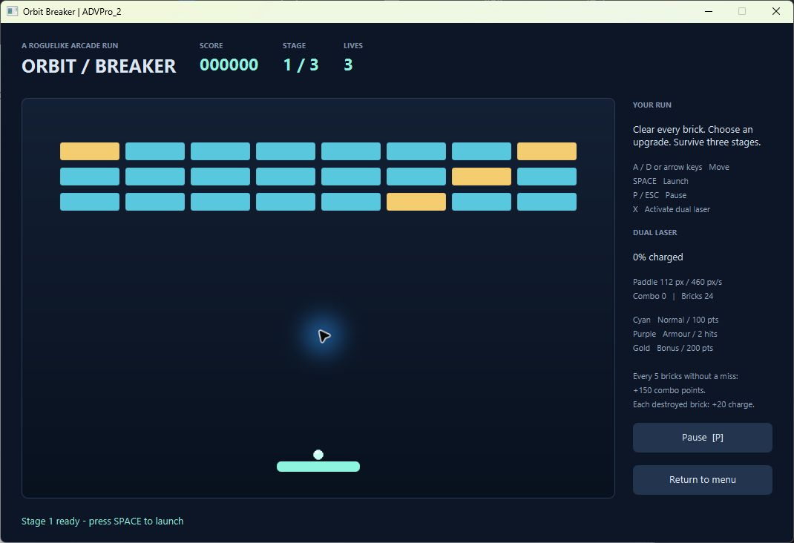

# ADVPro_2 - Orbit Breaker

A single-player JavaFX roguelike brick-breaker for SE233 Advanced Programming. Clear three stages, choose upgrades between stages, and use a charged dual laser to extend your run.



## Objectives and features

- Apply the supplied coursebook's event handling, OOP, exceptions, concurrency, logging, testing and Maven topics.
- Three stages with 24, 32 and 40 bricks; normal, two-hit armoured and bonus bricks.
- Three distinct random offers from five upgrades after each non-final stage.
- Persistent paddle width/speed, slower ball, extra life or score upgrades.
- Three initial lives, pause/resume, automatic pause on focus loss, replay and win/loss feedback.
- Original two-row sprite sheet distinguishes movement and impact; brick flashes/fades.
- Destroy ten bricks with the ball to charge the six-second automatic dual laser. After firing, the weapon cools down for eight seconds of active play, then must be charged again from zero. Laser kills never add charge, and no charge accumulates while firing or cooling down. Every fifth consecutive destruction also adds 150 points; a miss resets the combo.
- Normal bricks give 100 points, bonus bricks 200. Armour changes hit count, not base points. Treasure Hunter adds 50 points to every later destruction. Charge is capped at 100 and survives a missed ball; active lasers stop on life loss or stage completion and start the cooldown. Cooldown survives stage changes and freezes while paused, selecting upgrades or waiting to launch.

## Requirements and technologies

JDK **24 or newer** and Maven 3.8.5 or newer. Tested on Windows with **JDK 26.0.1**, compilation release **24**, JavaFX **26.0.1**, JUnit Jupiter **5.11.4**, Log4j API/Core **2.25.4**. No other application libraries.

JavaFX 26 requires JDK 24+: [official release highlights](https://openjfx.io/highlights/26/). Compiler 3.13.0, Surefire 3.5.2, JavaFX Maven 0.0.8 and Shade 3.6.2 are pinned in `pom.xml` as requested. JavaFX FXML/media/web dependencies are unnecessary for this programmatic interface.

## Setup and run

1. Install/configure JDK 24+ and Maven. Set `JAVA_HOME` to the JDK directory and add Maven's `bin` directory to `PATH` for standard `mvn` commands.
2. Open a terminal in this project directory.
3. Run `mvn clean compile`, then `mvn javafx:run`.

On this Windows computer, double-click **run.cmd**. It uses Maven on PATH, or an existing Maven wrapper distribution under `%USERPROFILE%\.m2\wrapper\dists`. Its helper uses `JAVA_HOME` when valid, otherwise a JDK installed under `%ProgramFiles%\Java`. It does not install software. This machine's Oracle `javapath` launcher did not respond during checking, so the installed JDK was invoked directly. First launch may need Internet access for Maven dependencies.

### IntelliJ IDEA

Open `pom.xml` as a Maven project. Set Project SDK and the Maven runner JRE to JDK 24+ (the installed JDK 26.0.1 works). Reload Maven. In the Maven tool window, execute `javafx:run`; execute Lifecycle > `test` for tests, or `package` for the JAR. The configured modular main class is `se233.advpro2/se233.advpro2.Launcher`. Do not manually add JavaFX SDK JARs to the project.

### Controls

| Control | Action |
|---|---|
| A / D or Left / Right | Move paddle |
| Space | Launch the docked ball |
| P or Escape | Pause / resume |
| X | Activate automatic dual laser at 100% charge during play |
| Upgrade button | Select one offered upgrade and prepare the next stage |

Losing focus pauses the run and clears held keys. Click Resume or press P after returning.

## Test and package

```text
mvn clean test
mvn clean package
java -jar target/advpro-2-1.0.0.jar
```

`test.cmd` runs the tests and keeps the result visible. Without Maven on PATH, use `tools\maven.cmd clean package` to package with the cached installation. The packaged JAR was launched and closed successfully on Windows; it includes Windows JavaFX natives and still needs JDK 24+. Rebuild on another OS to obtain that OS's JavaFX dependencies. This is not a bundled JRE or installer.

The shaded JAR prints an OpenJFX warning about the unnamed module. Its classpath launcher was tested successfully. Maven 3.8.5 also prints JDK 26 compatibility warnings from its own dependencies. Shade reports duplicate manifest/license metadata; these did not prevent packaging or startup. Keep upstream license notices if redistributing the application.

## Structure and responsibilities

```text
src/main/java/se233/advpro2/
  Launcher.java, JarLauncher.java    Application and JAR entry points
  model/                            Pure Java rules and game objects
  controller/                       Events, centralized errors, worker clock
  view/                             JavaFX controls, rendering, sprite viewports
src/main/java/module-info.java
src/main/resources/                 CSS, original sprite sheet, Log4j config
src/test/java/se233/advpro2/          Model and scheduling tests
examples/                           Demonstration walkthrough
logs/                               Runtime log (generated, ignored)
docs/                               Requirements, mapping, test evidence
```

See [class responsibilities and lecture mapping](docs/lecture-to-code.md), [requirements and rubric checklist](docs/requirements.md), [test results](docs/test-results.md), and [demonstration walkthrough](examples/demo-walkthrough.md).

## Known limitations

- Fixed 1068 x 700 content window and 800 x 540 play area; very small screens or large scaling may need display adjustment.
- Basic axis-aligned collision with short movement slices; no general physics engine. Corner responses are intentionally simple.
- The clock advances one fixed step per scheduled tick. A busy UI can slow the game rather than queue unlimited updates.
- No sound, save system, online leaderboard or external artwork; these are not mandatory in the supplied specification.
- Model tests verify completion and all upgrades. A full three-stage human playthrough and every upgrade screen interaction have not been completed; follow the manual checklist before demonstration.
- No ADVPro_1 source was supplied. The requested folder structure is followed, but its exact architecture or visual fidelity cannot be compared.
- Subjective rubric marks and your ability to explain the work are for the lecturers to assess. Read the walkthrough and trace the collision/clock logic yourself before presenting.
